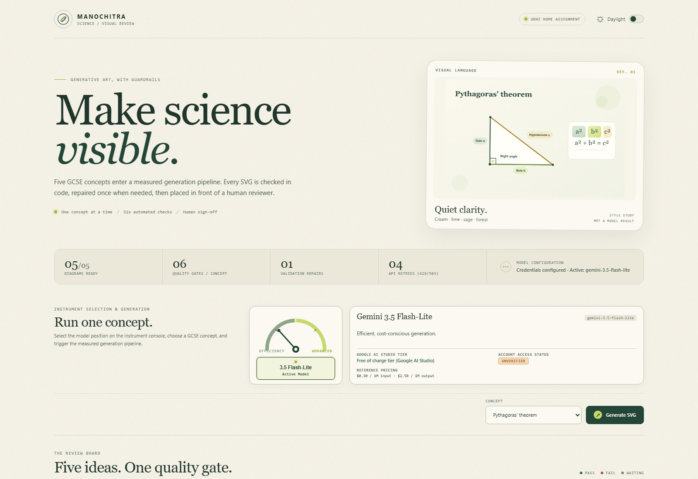
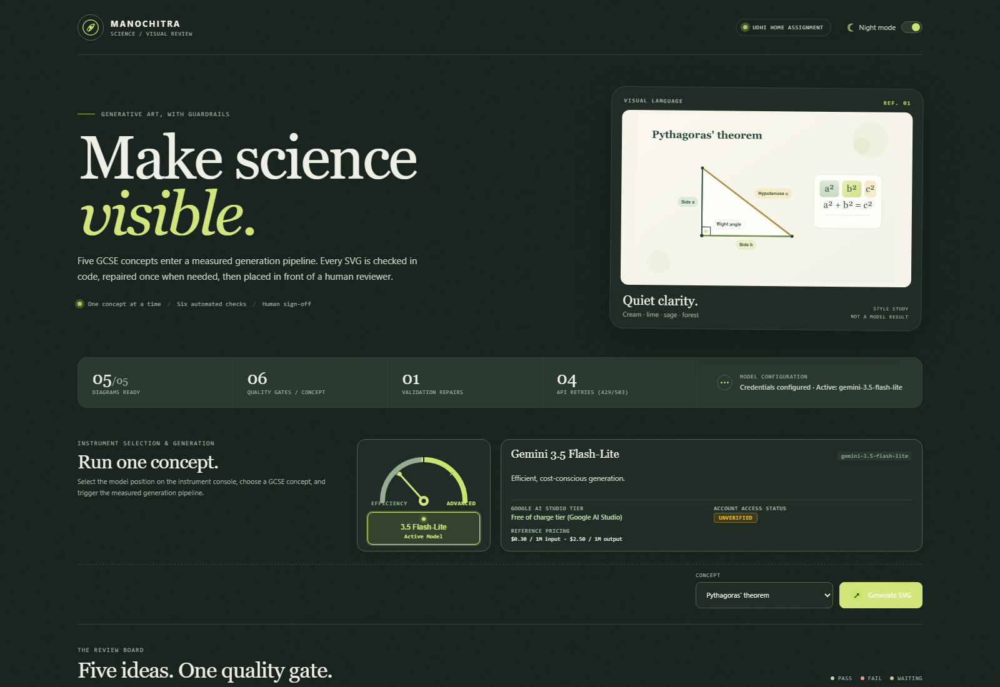

# MANOCHITRA — Science Diagram Maker

MANOCHITRA is a web application that generates animated science diagrams using Generative AI. It was developed for the Udhi Technologies home assignment.

The application takes a science concept, sends its description and diagram requirements to the Gemini API, and receives an SVG illustration. The generated SVG is then checked by a Python validation pipeline before it is stored and displayed on the website.

The main idea behind the project is simple: generating an SVG is not enough. A diagram also needs to be readable, stay within its canvas, contain the required labels, include meaningful animation and represent the concept correctly.

MANOCHITRA combines AI-based diagram generation with deterministic checks so that the output can be inspected before it is treated as a valid result.

The current implementation covers five GCSE-level concepts:

1. Pythagoras' theorem
2. Parts of a circle
3. Series circuit
4. Photosynthesis
5. States of matter

---

## Interface Preview

MANOCHITRA includes two visual themes. The same dashboard and science diagrams are available in both modes.

<div align="center">
  
  
</div>

<p align="center">
  <sub>Daylight / Light mode</sub>
  &nbsp;&nbsp;&nbsp;&nbsp;
  <sub>Night / Dark mode</sub>
</p>

---

## 1. The problem

Science diagrams are often used to explain ideas that are difficult to understand through text alone. However, generating these diagrams automatically introduces a few problems.

An AI model can return an SVG document that is syntactically valid but still produce a poor diagram. For example:

- A label may be outside the visible canvas.
- A shape may extend beyond the SVG viewBox.
- The diagram may contain fewer labels than required.
- The animation may be missing or attached to an element that is not visible.
- A scientific concept may be represented using the wrong structure.
- The model may return incomplete or malformed SVG markup.
- The API may fail because of rate limits, temporary server errors or timeouts.

Checking only whether an SVG can be opened in a browser does not address all these problems.

MANOCHITRA handles this through a generation and validation pipeline. The model creates the first version, Python checks its structure, and the application can request one corrective generation when the validation checks fail.

The application also records the generation details so that the result can be inspected rather than treated as an unexplained AI response.

## 2. What the application does

The current application is built around the following workflow:

1. The user selects a science concept.
2. The backend loads the concept description and builds a diagram-specific prompt.
3. The Gemini API generates an SVG illustration.
4. The backend extracts the SVG from the model response.
5. The SVG validator runs the required checks.
6. When a validation failure occurs, the pipeline can send one corrective request containing the failure details.
7. The final result, validation status and available usage information are recorded.
8. The frontend displays the diagram and its generation information.
9. The user can inspect the diagram and request regeneration when an improved result is needed.

The application also contains a preview interface for inspecting the SVG and its animation.

The five initial results are stored in `data/results.json`. They are loaded by the backend when the application starts, so opening the dashboard does not require a new Gemini request.

## 3. Technology stack

| Layer | Technology | Purpose |
|---|---|---|
| Frontend | HTML, CSS, JavaScript | Dashboard, diagram preview and user interaction |
| Backend | Python, FastAPI | API routes and application logic |
| AI integration | Google Gemini API | SVG generation |
| HTTP communication | HTTPX | Requests to the Gemini API |
| SVG processing | Python XML processing | Parsing and inspecting generated SVG |
| Validation | Python | Structural, geometry and concept-specific checks |
| Persistence | JSON files | Initial results, model runs and generation history |
| Frontend tests | Node.js test runner | JavaScript module tests |
| Backend tests | Pytest | API, pipeline, repository and validation tests |
| Browser testing | Playwright | Browser-level rendering and interaction tests |
| Hosting | Vercel | Public deployment |

The frontend is kept in plain HTML, CSS and JavaScript. A separate frontend framework was not necessary for this assignment, and keeping the interface lightweight makes the interaction between the browser and backend easier to follow.

## 4. System architecture

The project separates the application into a frontend, API layer, generation pipeline, validation modules and persistence layer.

```text
                         USER
                           |
                           v
                HTML / CSS / JavaScript
                           |
                           |
                  FastAPI application
                           |
                           v
                    API Routes
                           |
                           v
                Generation Pipeline
                           |
            +--------------+--------------+
            |              |              |
            v              v              v
       Concept Data   Prompt Builder   Retry Handler
                           |
                           v
                     Gemini Client
                           |
                           v
                    Gemini API
                           |
                           v
                    Model Response
                           |
                           v
                     SVG Extraction
                           |
                           v
                    SVG Validation
                           |
                 +---------+---------+
                 |                   |
                 v                   v
              PASS                FAIL
                 |                   |
                 |                   v
                 |             Repair Prompt
                 |                   |
                 |                   v
                 |              Gemini API
                 |                   |
                 |                   v
                 |             Re-validation
                 |                   |
                 +---------+---------+
                           |
                           v
                    Final Result
                           |
                           v
                  Results Repository
                           |
                           v
                      JSON Data
                           |
                           v
                   Frontend Dashboard
```

The diagram represents the main generation path. API retries, validation repair and persistence are separate operations with different responsibilities.

### 4.1 Frontend

The frontend is responsible for displaying the application and communicating with the backend.

It does not call Gemini directly. This is important because the API key must remain on the server.

The frontend contains the following modules:

| File | Responsibility |
|---|---|
| `frontend/index.html` | Main application structure and initial page |
| `frontend/styles.css` | Layout, typography, colours and responsive styles |
| `frontend/js/main.js` | Application initialization and event handling |
| `frontend/js/api.js` | Communication with backend API endpoints |
| `frontend/js/dashboard.js` | Dashboard and diagram rendering |
| `frontend/js/reviews.js` | Regeneration and related review interactions |
| `frontend/js/theme.js` | Daylight and Night theme handling |
| `frontend/js/exports.js` | Existing diagram and evidence export utilities |

The dashboard uses the data returned by FastAPI to display the saved diagrams. The browser does not need to request a new AI response just to load the initial page.

### 4.2 FastAPI backend

FastAPI connects the frontend to the application's internal services.

It receives requests, validates the input, calls the required service and returns a structured response.

The main application is:

`backend/app/main.py`

It creates the FastAPI application, registers the API routes, embeds the saved results into the initial HTML response and serves the frontend assets.

The backend also adds basic HTTP security headers and disables caching for the main HTML and API responses.

### 4.3 API routes

The route definitions are maintained in:

`backend/app/api/routes.py`

The API layer is responsible for handling requests rather than implementing the full generation logic itself.

The important application operations include:

| Method | Endpoint | Purpose |
|---|---|---|
| GET | `/api/health` | Check whether the backend is responding |
| GET | `/api/results` | Retrieve saved diagram results |
| GET | `/api/diagnostics` | Inspect non-secret application readiness |
| GET | `/api/models` | Retrieve model configuration information, where enabled |
| POST | `/api/generate/{concept_id}` | Generate and validate a diagram for one concept |
| POST | `/api/regenerate/{concept_id}` | Request a new version using previous output and feedback |
| GET | `/api/versions/{concept_id}` | Retrieve saved version history |

The exact API contract is defined in the backend route and model files.

For example, a generation request is associated with a concept ID such as:

```text
pythagoras
circle
series-circuit
photosynthesis
states-of-matter
```

This allows the backend to use the original concept definition instead of accepting an arbitrary science description without validation.

---

## 5. Backend project structure

The backend is divided into smaller modules so that changing one part of the generation process does not require rewriting the entire application.

```text
backend/
|
+-- app/
|   |
|   +-- main.py
|   |
|   +-- api/
|   |   +-- routes.py
|   |
|   +-- core/
|   |   +-- concepts.py
|   |   +-- config.py
|   |   +-- models.py
|   |
|   +-- services/
|   |   +-- prompt_builder.py
|   |   +-- gemini_client.py
|   |   +-- generation_pipeline.py
|   |   +-- retry_handler.py
|   |
|   +-- validators/
|   |   +-- svg_validator.py
|   |   +-- concept_structure_validator.py
|   |   +-- visual_quality_validator.py
|   |
|   +-- persistence/
|       +-- results_repository.py
|
+-- tests/
```

### 5.1 `core/concepts.py`

This file contains the five supplied science concepts.

Each concept has a stable identifier and its corresponding source description.

Keeping these descriptions in one place avoids repeating concept information inside API routes, prompts and frontend code.

It also makes it easier to add another concept later without changing the generation pipeline itself.

### 5.2 `core/config.py`

This module loads the application configuration and environment variables.

It is responsible for settings such as:

- Gemini API key
- Default Gemini model
- API timeout
- Maximum output tokens
- Retry timing
- Application environment
- Project, frontend and data paths

The API key is loaded on the backend. It is never required in browser JavaScript.

### 5.3 `core/models.py`

This module contains the structured model definitions used by the application.

These definitions help keep the data passed between routes and services consistent. They also make it easier to validate requests and organize generation results.

### 5.4 `services/prompt_builder.py`

The prompt builder creates the instructions sent to Gemini.

The prompt includes the science concept, the required SVG structure, the visual direction and the restrictions that make the output easier to validate.

The prompt also controls requirements such as:

- SVG dimensions and viewBox
- Required title and explanatory labels
- Allowed SVG elements
- Animation requirements
- Concept-specific diagram structure
- Visual layout and colour direction

Keeping prompt construction separate from the API client makes the system easier to maintain. Prompt changes do not need to be mixed with HTTP communication or validation code.

### 5.5 `services/gemini_client.py`

This module communicates with Google's Gemini API.

Its responsibilities include:

1. Preparing the API request.
2. Sending the request to the configured model.
3. Handling the HTTP response.
4. Extracting the generated content.
5. Reading token usage metadata when available.
6. Returning structured generation information to the pipeline.
7. Raising meaningful errors when the API request fails.

The client also keeps authentication on the backend.

The model name is configurable rather than being hardcoded throughout the application.

### 5.6 `services/retry_handler.py`

An external AI service may temporarily become unavailable.

For example, Gemini may return HTTP 429 because of rate limiting or HTTP 503 because the service is temporarily overloaded.

The retry handler provides bounded retry behaviour for these temporary failures.

The policy follows the assignment requirement:

- Make the initial request.
- Retry temporary HTTP failures using exponential backoff.
- Make no more than three retries after the initial request.
- Respect `Retry-After` when the API provides it.
- Return an error when the retry limit is reached.

A network retry and a validation repair are not the same thing.

A network retry sends the request again because the service did not successfully complete the request. A validation repair asks the model to correct an SVG that was generated but failed one or more checks.

Keeping these operations separate makes the retry counts and generation history easier to understand.

### 5.7 `services/generation_pipeline.py`

This is the main coordinator of the generation process.

It connects the concept data, prompt builder, Gemini client, retry handler, SVG validator and results repository.

The pipeline is responsible for deciding what happens next at each stage.

Its general sequence is:

1. Load the requested concept.
2. Build the generation prompt.
3. Send the prompt to Gemini.
4. Extract the SVG from the response.
5. Validate the SVG.
6. If validation fails, create a corrective prompt containing the failure details.
7. Request one repair generation.
8. Validate the repaired SVG again.
9. Collect the available token, cost, retry and timing information.
10. Store the final result.

The pipeline does not treat an unsuccessful repair as a successful result. The result retains its actual validation status.

---

## 6. SVG validation

A major part of MANOCHITRA is the validation performed after generation.

The model is responsible for creating the illustration, but the backend is responsible for checking the output against defined requirements.

The validation logic is divided between:

- `validators/svg_validator.py`
- `validators/concept_structure_validator.py`
- `validators/visual_quality_validator.py`

The release check currently verifies six code-validation gates for each saved diagram.

### 6.1 XML and SVG structure

The generated content must be a parseable SVG document.

The validator checks that the document has the expected SVG root and namespace and rejects unsafe or unsupported structures.

This helps prevent malformed markup and limits the kinds of SVG content the application needs to inspect.

### 6.2 ViewBox and element bounds

Every diagram is expected to fit within its SVG canvas.

The validator checks the geometry of the supported SVG primitives against the declared viewBox.

This includes elements such as:

- Circles
- Ellipses
- Rectangles
- Lines
- Polygons
- Polylines
- Text elements

The validator also considers supported animated coordinate ranges when checking bounds.

Elements that cannot be safely inspected by the current geometry checker are restricted rather than being accepted without verification.

This is intentionally a constrained SVG implementation. It is not a complete geometry verifier for every possible feature in the SVG specification.

### 6.3 Title and labels

A science diagram needs to explain what it represents.

The validator checks for the required document title and description, a visible topic heading and at least three visible explanatory text labels.

It also avoids counting hidden or definition-only text as visible explanatory content.

### 6.4 Animation

A diagram must contain animation that is attached to visible elements.

The validator checks for supported CSS keyframe or SMIL animation and restricts the animation properties that can be accepted.

This is important because an SVG can contain an animation declaration without showing any meaningful movement.

The presence of an animation tag alone should not be treated as proof that the diagram is animated correctly.

### 6.5 Scientific terminology

The custom terminology check looks for important terms associated with the selected science concept.

For example, a Pythagoras diagram should include the required mathematical terminology, while a photosynthesis diagram should include the relevant biological terms.

This check helps identify incomplete outputs, but it does not prove that the scientific explanation is correct.

### 6.6 Concept structure

The concept structure validator performs additional checks based on the selected diagram.

The checks include:

| Concept | Structural requirements |
|---|---|
| Pythagoras' theorem | Right-angle geometry, right-angle marker and relationship between the triangle's sides |
| Parts of a circle | Centre, radius, diameter and the relationship `d = 2r` |
| Series circuit | A single continuous loop and the expected series arrangement |
| Photosynthesis | Representation of the required inputs and outputs |
| States of matter | Three distinct states, an ordered solid arrangement and movement in liquid particles |

These checks are deterministic. They inspect the generated structure against defined rules rather than asking another language model to decide whether the first output is correct.

### A limitation worth understanding

Passing all six checks does not guarantee that a diagram is visually perfect or that every scientific relationship is correct.

For example, a label may technically fit inside the SVG but still look poorly positioned. A terminology check may find the required words without proving that the arrows represent the correct scientific process.

For this reason, the output still needs to be inspected in the browser. The validators are intended to catch known classes of problems, not replace scientific review.

---

## 7. Generation, repair and error handling

There are three different outcomes the application needs to distinguish.

### Successful generation

Gemini returns an SVG, the output passes validation, and the result can be saved.

### Validation failure

Gemini returns content, but one or more checks fail.

The pipeline creates a corrective prompt with the reasons for failure and requests one repair generation. The repaired SVG is checked again before it can be treated as a passing result.

### API failure

The model request itself may fail before an SVG is returned.

For temporary HTTP errors such as 429 and 503, the retry handler applies the configured retry policy. Once the retry limit is exhausted, the application returns an error instead of pretending that an SVG was generated.

The previously saved successful result should remain available when a new generation fails.

This distinction matters when examining a failed generation: a model-service problem, malformed model response and SVG validation failure require different fixes.

---

## 8. Data storage

The current application uses JSON files to store its saved results and generation records.

The relevant files are:

```text
data/
|
+-- results.json
+-- model_runs.json
+-- versions.json
+-- reviews.json
```

### `results.json`

Stores the canonical diagram results for the five supplied concepts.

This is the data source used for the initial dashboard.

### `model_runs.json`

Stores model execution information separately from the canonical assignment results.

This prevents an experimental generation from automatically replacing the saved canonical result.

### `versions.json`

Stores generated versions and their associated information, including validation status and regeneration metadata.

This is useful when a diagram is regenerated because the application can retain information about previous attempts rather than treating every output as an unrelated file.

### `reviews.json`

Stores review-related data used by the backend review workflow.

The exact review interaction shown in the browser depends on the enabled frontend workflow.

### Why JSON was used

For the assignment, JSON provides a simple way to store structured results without introducing a separate database service.

It is also easy to inspect manually during development.

However, it is not an ideal choice for a multi-user production application. File-based persistence introduces limitations around concurrent writes, shared state and deployment environments.

### Important deployment limitation

The current JSON implementation is suitable for local development and for packaging the initial result snapshot.

Vercel Functions do not provide a durable writable project filesystem. The application's `/tmp` fallback is temporary and may not be shared between function instances or deployments.

Consequently, generated versions and other runtime changes cannot be assumed to survive a cold start or be visible to every user.

A proper public deployment that needs durable generation history should use an external database. The initial committed diagrams can still be loaded as the starting dataset.

This limitation is important: the existence of JSON repository classes does not automatically mean that a deployed serverless application has permanent storage.

---

## 9. Generation metrics and cost tracking

Each generation records the usage information available from the Gemini response.

The application is designed to collect:

- Selected model
- Input tokens
- Output tokens
- Estimated API cost
- API retry count
- Validation repair count
- Validation results
- Pipeline latency
- Trace ID and stage timings

The token counts should come from the model's usage metadata. The application should not replace missing usage information with guessed values.

Cost is an estimate based on the configured model pricing and billing tier. It is not a billing invoice.

A useful distinction is maintained between:

- **API retries:** additional requests caused by temporary HTTP failures.
- **Validation repairs:** a corrective generation caused by an invalid SVG.

These are counted separately because they represent different stages of the application.

If the API does not provide the necessary token metadata, the cost should be reported as unavailable rather than as a fabricated zero.

The trace ID and stage timings help identify which part of the pipeline took the most time when investigating a generation request.

---

## 10. Local installation and setup

The following instructions use Windows PowerShell.

### Requirements

Install the following before running the project:

- Python 3.10 or a compatible version supported by the installed dependencies
- Node.js and npm
- Git
- A Google AI Studio API key

### Clone the repository

```powershell
git clone https://github.com/akshay-codingera/manochitra-science-diagram-maker.git

cd manochitra-science-diagram-maker
```

### Create a Python environment

```powershell
python -m venv .venv

.\.venv\Scripts\Activate.ps1

python -m pip install --upgrade pip
```

### Install Python dependencies

For the application:

```powershell
pip install -r requirements.txt
```

For the test and development dependencies, use:

```powershell
pip install -r requirements-dev.txt
```

The dependency files should be kept in sync with the packages actually used by the project.

### Configure the Gemini API key

Copy the example configuration:

```powershell
Copy-Item .env.example .env
```

Open `.env` and enter your own Google AI Studio API key.

The basic configuration is:

```env
GEMINI_API_KEY=your_google_ai_studio_key
GEMINI_MODEL=gemini-3.5-flash-lite
GEMINI_BILLING_TIER=free

GEMINI_TIMEOUT_SECONDS=90
GEMINI_MAX_OUTPUT_TOKENS=8192

RETRY_BASE_SECONDS=1
RETRY_MAX_SECONDS=30

APP_ENV=development
```

Use the actual supported model identifier configured for the project.

API key:

https://aistudio.google.com/api-keys

**Never commit `.env`.** It contains a private credential. The repository includes `.env.example` with placeholder values so another developer can create their own local configuration.

The Gemini key belongs on the backend. Do not place it in HTML, frontend JavaScript or a publicly exposed environment variable.

### Start the application

From the project root:

```powershell
python -m uvicorn app.main:app --app-dir backend --reload --port 8000
```

Open the application:

```text
http://127.0.0.1:8000
```

The FastAPI documentation is available at:

```text
http://127.0.0.1:8000/docs
```

The diagnostics endpoint is:

```text
http://127.0.0.1:8000/api/diagnostics
```

The diagnostics endpoint should not need to generate a diagram or call Gemini.

---

## 11. Generating the initial diagrams

The initial generation script is:

```text
scripts/generate_initial.py
```

Run it from the project root:

```powershell
python scripts/generate_initial.py
```

The script runs the concepts sequentially and updates the saved results as generations complete.

Generation requires a valid API key and consumes API quota.

The project also supports selecting a model through the script's model option, where that model is available and enabled:

```powershell
python scripts/generate_initial.py --model gemini-3.5-flash-lite
```

To force regeneration when supported by the script:

```powershell
python scripts/generate_initial.py --force --model gemini-3.5-flash-lite
```

After generation, inspect the saved SVGs and their validation details.

A result should not be changed manually from FAIL to PASS. If a diagram fails, inspect the returned SVG, determine why the validator rejected it and make a genuine correction.

<!-- RESULTS_TABLE_START -->
| Concept | Pass / fail | Estimated cost (USD) | Retries |
|---|---:|---:|---:|
| Pythagoras' theorem | PASS | $0.00000000 | 3 |
| Parts of a circle | PASS | $0.00000000 | 2 |
| Series circuit | PASS | $0.00000000 | 0 |
| Photosynthesis | PASS | $0.00000000 | 0 |
| States of matter | PASS | $0.00000000 | 0 |
<!-- RESULTS_TABLE_END -->

---

## 12. Running the tests

The project has separate backend and frontend tests.

### Backend

```powershell
.\.venv\Scripts\pytest.exe backend\tests\ -q
```

To see skipped tests and their reasons:

```powershell
.\.venv\Scripts\pytest.exe backend\tests\ -q -rs
```

### Frontend

```powershell
npm test
```

### JavaScript syntax check

```powershell
npm run check
```

### Release check

```powershell
.\.venv\Scripts\python.exe scripts\release_check.py
```

The release check examines the saved results and verifies that the expected concepts, validation results and usage information are present. It also confirms that the Gemini key is configured without printing the secret.

It does not prove that every future Gemini request will succeed.

### Latest local verification

The following results were obtained during local verification on 25 November 2026:

| Check | Result |
|---|---:|
| Saved science concepts | 5/5 passed |
| Code-validation gates per concept | 6/6 passed |
| Frontend tests | 9 passed |
| JavaScript syntax checks | Passed |
| Backend tests | 143 passed |
| Backend tests skipped | 2 |
| Backend test failures | 0 |

The two skipped backend tests are the live Gemini integration tests. They require `RUN_LIVE_TESTS=1` and a configured API key.

The skipped tests are not counted as passing live integration tests.

The test suite also reports dependency deprecation warnings. They do not currently cause the tests to fail, but they should be reviewed when updating the dependencies.

---

## 13. Deployment

The repository contains a Vercel configuration and a Python serverless entry point.

Relevant files:

```text
api/
|
+-- index.py

vercel.json
requirements.txt
```

The `api/index.py` file adds the backend directory to Python's module search path and imports the FastAPI application from `app.main`.

The Vercel configuration routes application requests to this entry point and serves frontend assets.

### Deploying through Vercel

1. Push the repository to GitHub.
2. Sign in to Vercel.
3. Select **Add New → Project**.
4. Import the MANOCHITRA GitHub repository.
5. Use the repository root as the project root.
6. Configure the Python application using the committed Vercel configuration.
7. Add the server-side environment variables in Vercel project settings.
8. Deploy the application.
9. Open the deployment URL and test the dashboard, API and generation workflow.

The key environment variables include:

```text
GEMINI_API_KEY
GEMINI_MODEL
GEMINI_BILLING_TIER
```

Do not put the actual API key in `vercel.json` or commit it to GitHub.

### Deployment checks

After deployment, verify:

- The home page loads.
- CSS, JavaScript and SVG assets load successfully.
- All five saved diagrams appear.
- The saved diagrams do not trigger an unexpected Gemini request on page load.
- The API health endpoint responds.
- A live generation request returns either a valid result or a useful error.
- The browser console does not contain unhandled errors.
- Runtime changes are not incorrectly assumed to be permanently stored in local JSON files.

A successful Vercel build is not enough to establish that the complete application works. The deployed URL must be tested.

---

## 14. Project limitations

There are a few limitations in the current implementation.

**Visual correctness:** The six validation gates catch defined structural and content problems, but they cannot prove that every diagram is scientifically or visually correct.

**SVG geometry:** The current bounds checks work on a supported subset of SVG elements. General paths, filters, masks and other complex SVG features are not covered by a complete browser-level geometry proof.

**Scientific verification:** The terminology and structure checks are rule-based. They cannot independently establish the truth of every scientific statement or relationship.

**Model availability:** Gemini may experience rate limits, high demand or temporary failures. The retry handler limits repeated requests, but it cannot guarantee model availability.

**Persistence:** JSON files are convenient during development but are not a replacement for a shared database in a serverless production environment.

**Usage and cost:** Token and cost information depends on the metadata returned by Gemini and the configured pricing schedule. An estimate should not be treated as an exact invoice.

These limitations are documented because a validator should not claim more than it can actually prove.

---

## 15. Future scope

There are several improvements that would make the application more suitable for wider use.

### 15.1 Database-backed persistence

Replace the runtime JSON repositories with a database such as PostgreSQL.

This would allow the application to retain generated versions, reviewer decisions and generation history across deployments and serverless instances.

The existing repository interfaces provide a starting point for separating storage implementation from the rest of the generation pipeline.

### 15.2 Improved review workflow

A more complete review system could include:

- Accept and reject decisions.
- Reviewer comments.
- A history of previous decisions.
- Multiple reviewers.
- A clear distinction between the current diagram and an older version.

For a shared review system, these decisions should be stored on the server rather than only in browser storage.

### 15.3 Feedback-based regeneration

Regeneration could make greater use of the reviewer's comments.

Instead of simply requesting another SVG, the system could identify the part of the previous diagram that needs improvement and include that information in the next prompt.

For example, a comment about an unclear diameter label should result in a more focused correction rather than an unrelated redesign.

### 15.4 Browser-based visual validation

The current validator checks supported SVG structures and estimated geometry.

A future version could render the SVG in a headless browser and measure the actual rendered bounding boxes. This would help detect clipping and text-layout problems that are difficult to establish using XML alone.

### 15.5 Stronger scientific checks

Each concept could have a more detailed set of rules.

For example, photosynthesis validation could check not only whether the required terms are present but also whether carbon dioxide and water are represented as inputs and oxygen and glucose as outputs.

A more detailed validator would need to inspect the relationships between labels, shapes and arrows instead of relying on terminology alone.

### 15.6 Background generation jobs

Long-running generation requests could be moved into a background job queue.

The browser could submit a generation request and receive a job identifier. It could then check the job status instead of holding one HTTP request open throughout model generation and validation.

### 15.7 Model evaluation

A controlled evaluation dataset could be used to compare different models using the same concepts and prompt conditions.

The evaluation could include:

- SVG validation pass rate.
- Scientific structure accuracy.
- Human visual ratings.
- Generation latency.
- Token usage.
- Estimated cost.
- Repair frequency.

A comparison should use actual repeated runs and a consistent evaluation method rather than a single successful response.

### 15.8 Authentication and shared access

If the application is used by multiple teachers or students, user accounts and role-based access could be introduced.

This would make it possible to associate generated diagrams and review decisions with specific users and retain an audit history.

---

## 16. Development notes and observed failures

The project has been developed and tested through separate stages rather than treating every generated SVG as immediately acceptable.

One important failure case involved an SVG element extending beyond the declared viewBox. The SVG could be parsed, but its geometry did not fit the canvas. The bounds validator rejected it.

That distinction is important: valid XML does not automatically mean valid diagram geometry.

Other areas that require attention during generation include label positioning, animation visibility, diagram proportions and concept-specific structure.

The correct way to handle such failures is to inspect the returned SVG and validation details, identify the failing rule, and then correct the prompt or validator as appropriate.

Only failures supported by actual logs or test evidence should be added to this section. A failure should not be described as observed merely because it is a possible failure mode.

---

## 17. Repository structure

The main repository layout is:

```text
manochitra-science-diagram-maker/
|
+-- api/
|   +-- index.py
|
+-- backend/
|   |
|   +-- app/
|   |   +-- api/
|   |   +-- core/
|   |   +-- persistence/
|   |   +-- services/
|   |   +-- validators/
|   |   +-- main.py
|   |
|   +-- tests/
|   +-- requirements.txt
|
+-- data/
|   +-- results.json
|   +-- model_runs.json
|   +-- versions.json
|   +-- reviews.json
|
+-- frontend/
|   +-- assets/
|   +-- js/
|   +-- tests/
|   +-- index.html
|   +-- styles.css
|   +-- package.json
|
+-- scripts/
|   +-- generate_initial.py
|   +-- release_check.py
|
+-- .github/
|   +-- workflows/
|       +-- ci.yml
|
+-- .env.example
+-- .gitignore
+-- package.json
+-- pytest.ini
+-- requirements.txt
+-- requirements-dev.txt
+-- vercel.json
+-- README.md
```

Some additional development and verification scripts may exist locally. They are not required to understand the main application flow.

---

## 18. AI tools and development approach

AI assistance was used during development, but the application is organized into separate Python modules and JavaScript files so that its behaviour can be inspected and tested.

The tools used include:

- **Antigravity:** assistance with implementation, code changes and development workflow.
- **ChatGPT:** architecture discussions, debugging guidance, code explanations and documentation.
- **Gemini API:** generation of the SVG diagrams used by the application.

The purpose of separating the system into modules is to make it possible to understand and modify each stage independently.

The important parts of the application are the generation pipeline, Gemini client, retry handler, SVG validators and persistence layer. These define how a request moves through the system and how the result is handled.

The code should be understood and tested before making changes. The automated tests provide a useful starting point, but they do not replace inspecting the generated diagrams in the browser.

---

## 19. Closing

MANOCHITRA is an attempt to make AI-generated science diagrams more controlled and easier to inspect.

The Gemini model handles illustration generation. The Python backend manages the request, validates the SVG and records the result. The browser provides a way to inspect and interact with the generated diagrams.

The project deliberately keeps those responsibilities separate.

The next stage is to improve persistence, strengthen visual and scientific validation, and make the review workflow suitable for multiple users.
